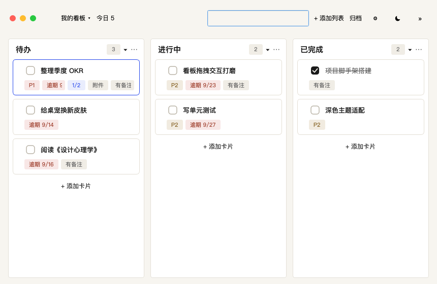
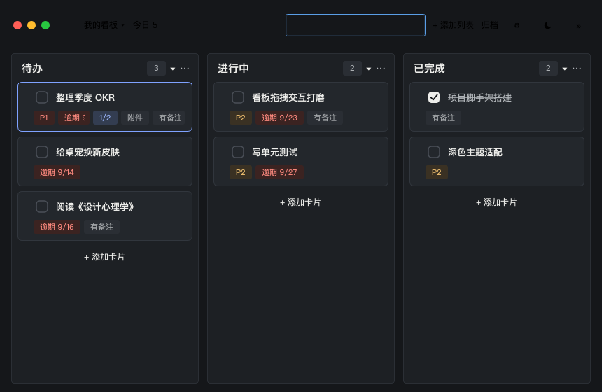
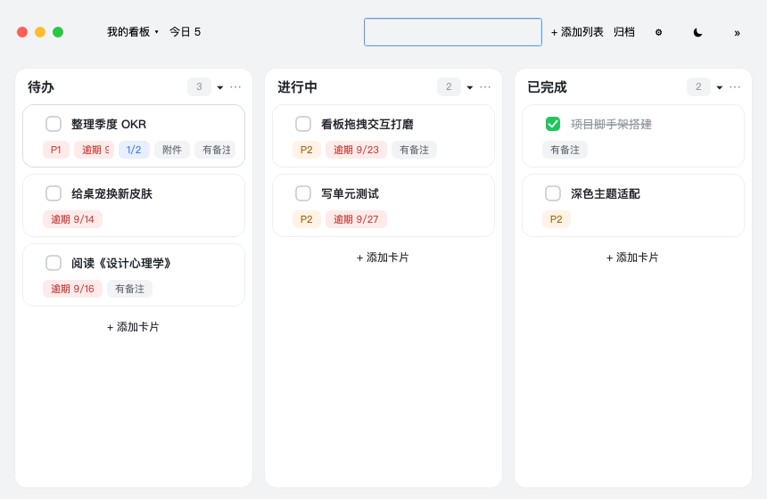
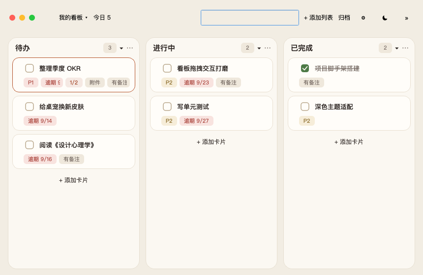
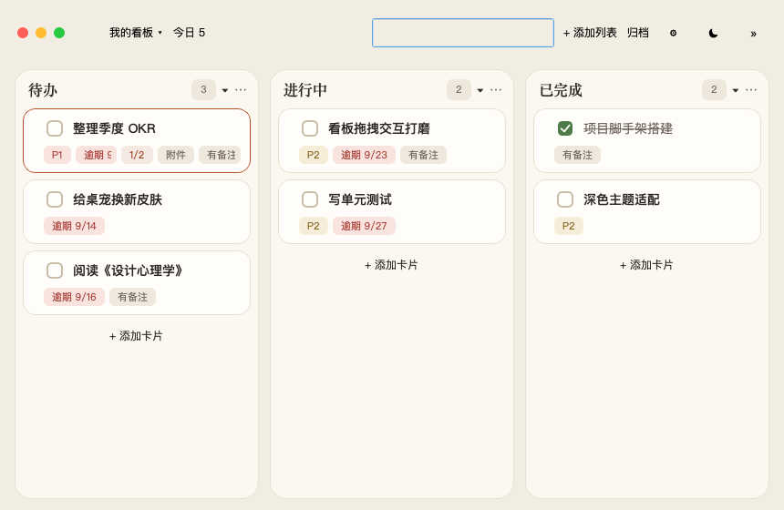
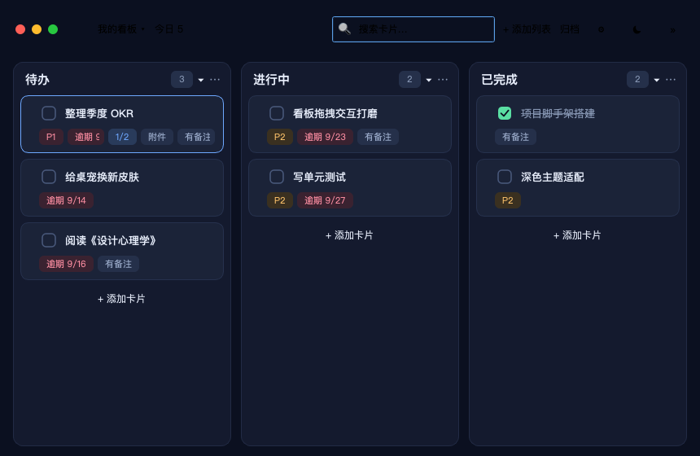
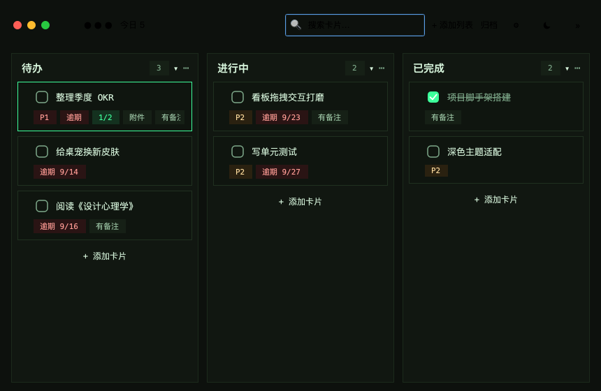
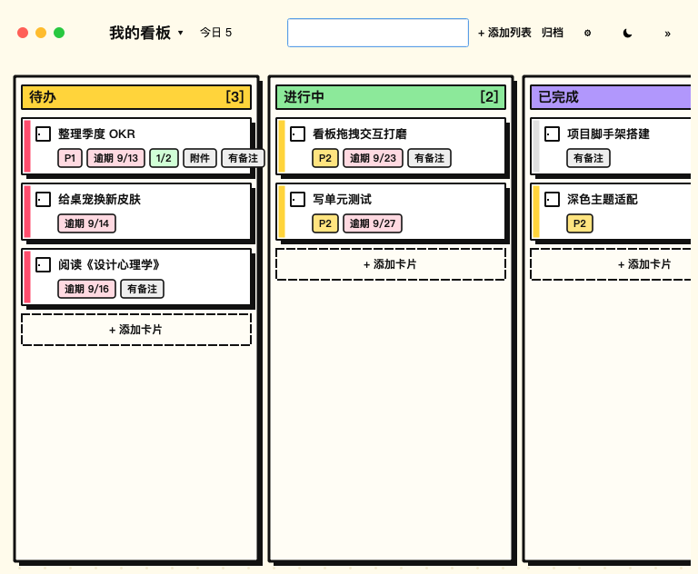
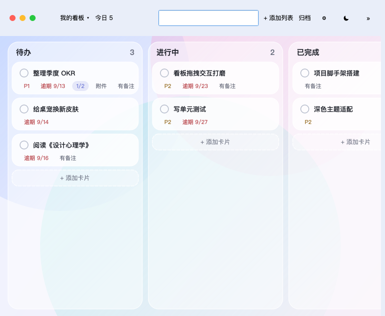

# 桌宠看板 · 设计风格方向（7 个候选）

> **进度：已落地。** 其中 1 / 3 / 5 / 6 / 7 已实现为可切换的「视觉皮肤」，默认 1（瑞士排版），
> 选择持久化。实现说明见 [`ui-skins.md`](./ui-skins.md)，真实运行截图见
> [`style-previews/skin-*.png`](./style-previews/)（本页下方是设计阶段的概念预览图，两者可对照看）。
>
> 配套可视化：[`style-directions.html`](./style-directions.html)（含每个方向的仿制预览图与对比度实测）
> 预览图原件：[`design/style-previews/`](./style-previews/)

## 先说结论：为什么现在「平」

截图（`smoke_board.png`）逐像素拆下来，平感是三个维度同时「没有反差」叠加的结果：

| 维度 | 现状 | 问题 |
|---|---|---|
| 面明度 | 板底 `#EEF2F7` → 列 `rgba(255,255,255,.86)` → 卡 `#FFFFFF` | 三级只差 4–6%，层次实际靠 1px `rgba(29,39,51,.14)` 描边撑着 |
| 圆角 | `shell 14 / panel 12 / card 10 / control 8 / chip 6` | 全是「软方」，大物件和小物件没有形态差异 |
| 徽章 | 6 种语义色，同一个 11px 淡色药丸 | 优先级、逾期、备注、附件、清单进度看起来等重 |
| 字重 | 列头 15/bold、卡标题 13/500、徽章 11/400 | 只有两档，且中间差得太近 |

**结论：不需要加装饰（渐变、阴影、插画），需要的是在某一维度上做极端反差。** 下面 7 个方向各选一个维度打透。

---

## 1. 瑞士排版 · Editorial

*Swiss / Editorial typography* — **靠「排版反差」而不是「装饰」把界面立起来**

| 现在的「平」在哪 | 这个方向怎么做 |
|---|---|
| 现在的问题是**层级三条线差不多粗**：列头 15px 粗体、卡片标题 13px 半粗、徽章 11px 灰色药丸，四件事看起来一样重。 | 列头做「杂志刊头」（黑体 + 色块编号），徽章**去底、改成纯文字 + 一条细竖线**，纸色底 + 墨黑字 + 单一电光蓝只给当前选中项。大反差 + 留白，是「专业感」最便宜的一条路。 |

**关键特征**

- 纸色 #F7F5F0 + 墨黑 #1A1A1A，零渐变
- 圆角收到 4–6px（现在是 10–14px）
- 徽章无底 → 变成细竖线 + 11px 文字（图中每条徽章前一根青蓝竖线，替代药丸底）
- 强调色只出现 1–2 处（当前卡 / 主按钮）
- 列头 15px 但字重提到 800（图中黑体字重），卡片标题保持 13px/500

**落地成本**：低到中。主要是 `COLORS/DARK_COLORS` 一份新表 + `_board_qss` 里卡片/徽章/列的几条规则；自绘部分只动卡片左侧色条（改成色点）。

**涉及文件**

- `app/config.py: COLORS / DARK_COLORS`
- `app/views/tokens.py: _RADIUS_NAMES（整体调小）`
- `app/views/board_view.py: _board_qss / CardWidget.paintEvent`
- `app/views/theme.py: global_qss（按钮、菜单、滚动条）`

**风险**

- 中文黑体在 800 权重下会「糊」，需要 `QFont.setWeight(QFont.Black)` 测试一遍字重真实可用性
- 去底徽章在窄卡（LIST_WIDTH=272）里更省横向空间，反而更宽裕

**对比度实测**（AA 门槛 4.5:1）

| 前景 | 背景 | 比值 | 用途 |
|---|---|---|---|
| `#2547EB` | `#F7F5F0` | 6.06 | 强调色作文字 |
| `#98321F` | `#F8E7E6` | 6.25 | 逾期徽章 |
| `#0F6B45` | `#E2EFE9` | 5.53 | 完成色 |
| `#1A1A1A` | `#F7F5F0` | 15.97 | 正文 |

---

## 2. 柔和极简 · Soft Minimal

*Soft minimal / product UI (飞书·Notion 风)* — **最稳的商业化路线：靠「描边 vs 无描边」和「留白」制造层次**

| 现在的「平」在哪 | 这个方向怎么做 |
|---|---|
| 现在是「每一层都有边框 + 同一个浅色底」，所以卡片、列、板底糊成一个面。 | 把所有描边降成 `#ECEDF0` 一级，面板用 14px 大圆角、卡片 12px，卡片和面板都变成**白色浮岛**，靠 `bg` 从冷灰换成更中性的 `#F2F3F5` 把浮岛托起来。任何位置都不会「花」，也最容易做成多种配色变体（换 accent 就是另一个品牌）。 |

**关键特征**

- 冷灰底 #F2F3F5 + 纯白卡片/面板
- 描边统一 `#ECEDF0`（现在 14% 墨色，太黑）
- 圆角 14/12/8，卡片和面板几乎同色，靠底差分
- 徽章浅底圆角药丸（保留现在的语义色）
- 可选：卡片 0 0 4px rgba(0,0,0,.04) 极淡投影（见「性能」）

**落地成本**：**最低**。只改色表 + 3 条圆角 token + 描边色，不动任何布局和自绘逻辑，一天内可完成且风险极小。

**涉及文件**

- `app/config.py: COLORS / DARK_COLORS（主要是 border / bg / panel 三组）`
- `app/config.py: UI_RADIUS_* 四个常量`
- `app/views/board_view.py: #cardFrame / #listColumn 的 border 规则`

**风险**

- 和现在最像，用户可能觉得「没变」，需要配合圆角和底色一起推
- 投影（QGraphicsDropShadowEffect）不要用在每张卡上：motion.py 已实测 0.20ms/帧/卡，300 卡会掉帧

**对比度实测**（AA 门槛 4.5:1）

| 前景 | 背景 | 比值 | 用途 |
|---|---|---|---|
| `#2B63F0` | `#FFFFFF` | 5.07 | 强调色作文字（#3370FF 只有 4.28，作按钮/强调必须加深一档） |
| `#C63A34` | `#FDEBEA` | 4.50 | 逾期徽章（刚好卡线） |
| `#15803D` | `#E6F5EC` | 4.45 | 完成色（差 0.05，需压深一档到 #146C36 = 5.77） |
| `#1F2329` | `#FFFFFF` | 15.78 | 正文 |

---

## 3. 暖纸手帐 · Warm Paper

*Warm paper / zine & planner* — **和「桌宠」这个 IP 气质最合的一家：纸、暖色、圆润**

| 现在的「平」在哪 | 这个方向怎么做 |
|---|---|
| 现在的冷蓝灰底色 + 纯白卡片，和圆滚滚的奶糖桌宠是两套气质，展开看板时会有割裂感。 | 奶油纸底 + 陶土红 + 暖棕墨，把「看板」做成一本摊开的手帐。列头可选换成宋体（衬线）——中文里衬线体自带「纸质/印刷」联想，和桌宠的可爱形成反差萌而不是冲突。 |

**关键特征**

- 奶油纸 #F2EDE3 + 纯白 #FFFDF9 卡片
- 强调色陶土 #9A3412（替代蓝）
- 圆角放大到 14–18（比现在更圆、更软）
- 列头可切宋体 / 标题加 0.2px 字距
- 玻璃工具栏换成不透明纸色，去掉半透明

**落地成本**：低到中。一份新色表 + 列头字体；切换成衬线体需要 `QFont('Songti SC')`，Windows 侧要回退到 `SimSun`，需要测试中文在 16px 下的清晰度。

**涉及文件**

- `app/config.py: COLORS / DARK_COLORS / PET_SKINS（桌宠配色也同步暖化）`
- `app/views/board_view.py: 列头字体、卡片圆角`
- `app/views/theme.py: 深色版要单独配一套「暖黑」而不是冷黑`

**风险**

- 暖色底 + 浅黄徽章容易「糊」，warning 色需要压深（实测 #7D5A12 在 #F6EDD9 上有 4.8:1）
- 衬线中文字体在 macOS 之外不一定存在，必须准备回退栈

**对比度实测**（AA 门槛 4.5:1）

| 前景 | 背景 | 比值 | 用途 |
|---|---|---|---|
| `#9A3412` | `#FFFDF9` | 7.19 | 强调色作文字 |
| `#98321F` | `#F8E3DF` | 6.06 | 逾期徽章 |
| `#3F6B3A` | `#E3EEE0` | 5.21 | 完成色 |
| `#2B2421` | `#FFFDF9` | 15.01 | 正文 |

---

## 4. 深色专注 · Nocturne

*Dark-first / focus mode* — **不是「把浅色反相」，而是给深色单独做一套层级**

| 现在的「平」在哪 | 这个方向怎么做 |
|---|---|
| 现在的深色其实是浅色反相：卡片 #262A33 压在面板 rgba(35,38,46,.92) 上，两者只差一档，列和卡几乎分不开。 | 深色界面里**亮 = 近**。把板底压到 #0B1020、列 #141A2E、卡片 #1B2338 三级台阶拉开，徽章全部用「该色 20% 叠在卡片上」的低饱和软底，六个标签色不会跳出来抢标题。深色做对了，比任何浅色方案都更有「高级感」。 |

**关键特征**

- 三级近黑色阶（#0B1020 / #141A2E / #1B2338）
- 强调色 #6EA8FF 只在交互态出现
- 徽章软底 = 语义色 18–20% 叠底，不透明感
- 工具栏按钮 6% 白，不做高光
- 浅色模式作为「副模式」跟着同一套 token

**落地成本**：中。深色目前已在 `DARK_COLORS` 里，主要是重新配一套色 + 徽章软底色（DARK_LABEL_COLORS 已有类似思路）；还要检查 `focus_ring` 在三级色阶上的达标。

**涉及文件**

- `app/config.py: DARK_COLORS / DARK_LABEL_COLORS`
- `app/views/board_view.py: paintEvent 的渐变停靠色`
- `tests/test_contrast.py: 新组合需要全量重跑`

**风险**

- 用户白天用得多的话，深色为主的方案可能反向降低可用性
- OLED 下纯黑底 + 大面积描边会出现「光晕」，建议用近黑而非 #000

**对比度实测**（AA 门槛 4.5:1）

| 前景 | 背景 | 比值 | 用途 |
|---|---|---|---|
| `#6EA8FF` | `#1B2338` | 6.48 | 强调色作文字/边框 |
| `#FF8FA3` | `#3A2230` | 6.69 | 逾期徽章 |
| `#5ADFA3` | `#173329` | 8.12 | 完成色 |
| `#E8EEFB` | `#1B2338` | 13.43 | 正文 |

---

## 5. 等宽终端 · Terminal

*Monospace / instrumentation* — **把「任务卡」变成「进程」，最不像 AI 的一种**

| 现在的「平」在哪 | 这个方向怎么做 |
|---|---|
| 圆角卡 + 药丸徽章的组合，现在几乎已经是 AI 产物和模板 SaaS 的默认长相。 | 零圆角、等宽字、徽章写成 `!逾期 9/13` 这样的行内文本、列头带 `[03]` 计数、列底 `> + 添加卡片 _`。信息密度高、边界锐利，一眼看去像 IDE 而不是网页。适合「工具控 / 开发者」人格。 |

**关键特征**

- Menlo / SF Mono，中文回退 PingFang
- 全部 0 圆角，1px 线框，底色只差 1–2%
- 徽章去底 → 前缀符号（! ~ # .）+ 文字
- 留一条 1px 网格出血，模拟标尺
- 进度/番茄用 [███░░] 字符条

**落地成本**：中。QSS 能做掉 80%，但「徽章前缀符号」和「字符进度条」要改 `CardWidget.rebuild` 的 meta_items；等宽中文回退要测（Menlo 没有中文字形）。

**涉及文件**

- `app/views/board_view.py: CardWidget.rebuild（徽章文本）、_board_qss 全部圆角`
- `app/views/theme.py: global_qss 的按钮/输入框/菜单圆角`
- `app/config.py: 新增 UI_FONT_FAMILY / UI_FONT_MONO 两个 key`

**风险**

- 大量 0 圆角 + 等宽中文，长时间看会累，更适合作为可选皮肤而不是默认
- 11px 等宽中文字形偏糊，徽章字号可能要升到 11.5–12px

**对比度实测**（AA 门槛 4.5:1）

| 前景 | 背景 | 比值 | 用途 |
|---|---|---|---|
| `#3DFF9B` | `#0D110D` | 14.48 | 强调色 |
| `#FF9C95` | `#2A1414` | 8.64 | 逾期 |
| `#9FC9A8` | `#162016` | 9.10 | 次要文字 |
| `#D7F5DC` | `#0F150F` | 15.85 | 正文 |

---

## 6. 新粗野主义 · Neubrutalism

*Neo-brutalism* — **2.5px 黑描边 + 硬投影，把「平」直接打碎**

| 现在的「平」在哪 | 这个方向怎么做 |
|---|---|
| 所有元素都是同一档细描边 + 同一档圆角，「平」的本质是**缺乏重量差**。 | 粗黑边 + 右下 5px 硬阴影 + 高饱和色块，每张卡都像一枚实体贴纸。它和桌宠的「卡通」属性是同一语言，情绪价值极高。但这是**强风格**，一旦用就要全套统一，否则会脏。 |

**关键特征**

- 2.5px #111 描边，圆角 0–3px
- 卡片右下 5px 无模糊投影
- 列头做成高饱和色块（黄 / 绿 / 紫）
- 徽章：1.6px 描边 + 高饱和浅底
- 背景撒 3px 圆点做纸张纹理

**落地成本**：**中高**。QSS 的 `box-shadow` 在 Qt 里**不存在**，硬投影要用 `QGraphicsDropShadowEffect(offset=5, blur=0, color=#111)` 或自绘；每张卡加 effect 的性能风险（motion.py 实测）必须先用 300 卡压测。

**涉及文件**

- `app/views/board_view.py: #cardFrame/#listColumn 描边、ListHeader 色块、CardWidget.paintEvent`
- `app/views/motion.py: 若走 effect，需要验证帧率`
- `app/config.py: 新增 shadow token / 列头色映射`

**风险**

- 300 卡 + effect ≈ 60ms/帧，几乎可以确定不能用 effect，只能自绘
- 强风格与设置/日历/对话框等其他 5 个界面的一致性成本高

**对比度实测**（AA 门槛 4.5:1）

| 前景 | 背景 | 比值 | 用途 |
|---|---|---|---|
| `#111111` | `#FFFBEB` | 18.21 | 正文 |
| `#111111` | `#FFE480` | 14.98 | warning 徽章 |
| `#111111` | `#FFD9E1` | 14.62 | danger 徽章 |

---

## 7. 玻璃拟态 · Frosted

*Glassmorphism* — **好看，但在桌面常驻小工具上是坑最多的一个**

| 现在的「平」在哪 | 这个方向怎么做 |
|---|---|
| ——（不在「太平」这个问题的解法里，列出来是为了排除） | 三团柔光 + 半透明面板 + 大圆角，视觉冲击最强。如果桌宠看板要出现在桌面截图的「分享位」，它是射程最远的一张。**但它和你现在的定位冲突**：常驻桌面 → 需要随时可读 → 半透明面板会与背后的壁纸/窗口混色。 |

**关键特征**

- 背景三团柔光渐变
- 面板 rgba(255,255,255,.75) + 1px 白边
- 卡片几乎不透明（.96），只让面板透
- 圆角 20 / 16 / 12
- 徽章 10px 全圆药丸

**落地成本**：**高**。Qt 没有 backdrop-filter，要做伪毛玻璃需要 `QGraphicsBlurEffect` 截背景重绘，或者用 `WA_TranslucentBackground` + 系统 blur（macOS 可以，Windows 不行），跨平台不一致。

**涉及文件**

- `app/views/board_view.py: paintEvent（柔光渐变，逐帧成本要压测）`
- `app/views/notes_popover.py / today_popover.py: 已有结论「浮层必须不透明，否则文字叠影」`

**风险**

- 桌面看板背后就是别的窗口，半透明面板可读性会随壁纸剧烈波动
- 柔光渐变每帧重绘：需和现有 `_bg_gradient_cache` 一样做缓存，否则缩放动画会掉帧

**对比度实测**（AA 门槛 4.5:1）

| 前景 | 背景 | 比值 | 用途 |
|---|---|---|---|
| `#20232B` | `rgba(255,255,255,.75) 合成后` | ~10 | 正文（取决于背后壁纸，不可控） |

---

## 推荐组合

1. **默认：1 瑞士排版 · Editorial** — 解决「平」的核心是层级反差，改造成本最低（只动色表 + 圆角 + 徽章样式），和现有 828 项测试的兼容面最小。
2. **深色：4 深色专注 · Nocturne** — 把深色当独立主题做，而不是浅色反相；这是现在深色「最平」的直接原因。
3. **桌宠配色：3 暖纸的一片** — 桌宠四套皮肤（奶糖/雪团/可可/子夜）已经偏暖，配色向纸色靠一点，展开态与折叠态才是同一个产品。
4. **彩蛋皮肤：5 等宽终端** — 挂到工具栏/设置里当皮肤，和桌宠皮肤同一个入口；低风险满足「不想太平」的极端诉求。

## 与现有代码的兼容性备忘

- **色表**：`app/config.py: COLORS / DARK_COLORS` 被 `theme.py` 与 `board_view.py: _board_qss` 直接引用；换风格优先只换这张表 + `UI_RADIUS_*`，不动控件结构。
- **硬编码的圆角**：`CardWidget.paintEvent` 里色条裁剪路径写死 `10`（对齐 `UI_RADIUS_CARD`），改圆角 token 时必须同步。
- **阴影**：Qt QSS 没有 `box-shadow`；`motion.py` 已实测 `QGraphicsDropShadowEffect` 0.20ms/帧/卡，300 卡场景不可用，只能用自绘。
- **对比度护栏**：`tests/test_contrast.py` 会把 `COLORS` 与 `DARK_COLORS` 全组合遍历断言，任何新色表都要跑一遍。
- **token 棘轮**：`tests/test_design_tokens.py` 禁止 QSS 里的字号/圆角/内边距字面量，新风格必须走 `tokens.*`。
